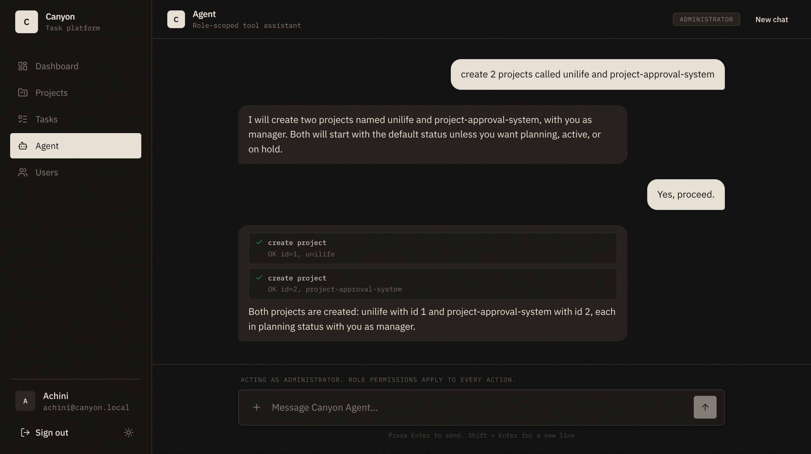

# Canyon

Canyon is a project and task management platform at [canyon.achini.space](https://canyon.achini.space), built as a Bun workspace monorepo with a Next.js 16 frontend, an Express 5 REST API, Drizzle ORM over MySQL, and a role-aware tool-calling assistant.



## Features

- **Role-based workspaces.** Separates permissions across administrators, project managers, and team members for creating projects, assigning members, and updating task state.
- **Tool-calling chat assistant.** The chat interface at `/agent` invokes backend project, task, member, and user services through DeepSeek tool calls under the signed-in user's server-side role checks.
- **Shared workspace types.** `packages/shared` exports `@canyon/shared` TypeScript contracts and Zod schemas consumed by both `canyon-be` and `canyon-fe`.
- **Cookie-backed JWT authentication.** Issues access tokens and HTTP-only refresh cookies with support for same-origin Next.js API rewrites or shared parent domains via `COOKIE_DOMAIN`.

## Tech stack

| Layer | Choice |
| --- | --- |
| Runtime and workspaces | [Bun](https://bun.sh) |
| Frontend | Next.js 16, React 19, Tailwind CSS 4, Radix UI, React Hook Form, Zod 4 |
| Backend | Express 5, TypeScript, Helmet, JWT |
| Database | MySQL with `mysql2` and [Drizzle ORM](https://orm.drizzle.team) |
| Chat model | DeepSeek API |

## Getting started

### Prerequisites

- [Bun](https://bun.sh) 1.3 or later
- MySQL 8 or a compatible MariaDB database
- A [DeepSeek](https://platform.deepseek.com) API key for `/agent`

### Install and run

1. Install workspace dependencies from the repository root:

```bash
git clone https://github.com/achinisubasinghe/canyon.git
cd canyon
bun install
```

2. Configure, migrate, seed, and start the backend API on port `3001`:

```bash
cd canyon-be
cp .env.example .env
bun run db:migrate
bun run db:seed
bun run dev
```

3. In another terminal, configure and start the Next.js frontend on port `3000`:

```bash
cd canyon-fe
echo 'NEXT_PUBLIC_API_URL=http://localhost:3001/api/v1' > .env.local
bun run dev
```

Open [http://localhost:3000](http://localhost:3000).

### Seeded accounts

Running `bun run db:seed` in `canyon-be` clears non-seed records and restores three accounts:

| Email | Password | Role |
| --- | --- | --- |
| `achini@canyon.local` | `achini123` | Administrator |
| `akash@canyon.local` | `akash123` | Project Manager |
| `emalin@canyon.local` | `emalin123` | Team Member |

## Scripts

Run these scripts from the repository root:

| Command | Behavior |
| --- | --- |
| `bun run dev:be` | Start the `canyon-be` Express API in watch mode |
| `bun run dev:fe` | Start the `canyon-fe` Next.js development server |
| `bun run test` | Run backend tests with `bun test` |
| `bun run typecheck` | Run `tsc --noEmit` on `canyon-be` |
| `bun run ci` | Run backend typecheck, backend tests, frontend lint, and frontend build |

## Deployment

Authentication relies on an HTTP-only `refreshToken` cookie. When the frontend runs on Vercel at `canyon.achini.space` and the API runs on Render, proxy `/api/v1/*` through Next.js rewrites so the browser receives a first-party cookie on the frontend host.

### Frontend environment variables

| Variable | Example | Purpose |
| --- | --- | --- |
| `NEXT_PUBLIC_API_URL` | `/api/v1` | Browser base path routed through Next.js |
| `API_BACKEND_URL` | `https://canyon-xtpk.onrender.com` | Server-only rewrite target in `next.config.ts` |

### Backend environment variables

| Variable | Example | Purpose |
| --- | --- | --- |
| `NODE_ENV` | `production` | Enables production cookie settings |
| `CORS_ORIGIN` | `https://canyon.achini.space` | Allowed frontend origin |
| `COOKIE_SAME_SITE` | `lax` | `SameSite` attribute for the refresh cookie |
| `COOKIE_DOMAIN` | `.achini.space` | Optional parent domain when sharing cookies across subdomains |
| `DB_HOST`, `DB_PORT`, `DB_USER`, `DB_PASSWORD`, `DB_NAME` | Aiven MySQL values | MySQL connection parameters |
| `JWT_ACCESS_SECRET`, `JWT_REFRESH_SECRET` | Random secret strings | Signing keys for access and refresh tokens |
| `DEEPSEEK_API_KEY` | `sk-...` | API key for the `/agent` tool-calling assistant |

## Project structure

```text
canyon/
├── canyon-be/
│   ├── drizzle/
│   ├── src/
│   │   ├── controllers/
│   │   ├── db/
│   │   ├── middleware/
│   │   ├── routes/
│   │   ├── services/
│   │   └── index.ts
│   └── package.json
├── canyon-fe/
│   ├── src/
│   │   ├── app/
│   │   ├── components/
│   │   └── lib/
│   ├── next.config.ts
│   └── package.json
├── packages/
│   └── shared/
│       └── src/
└── package.json
```
